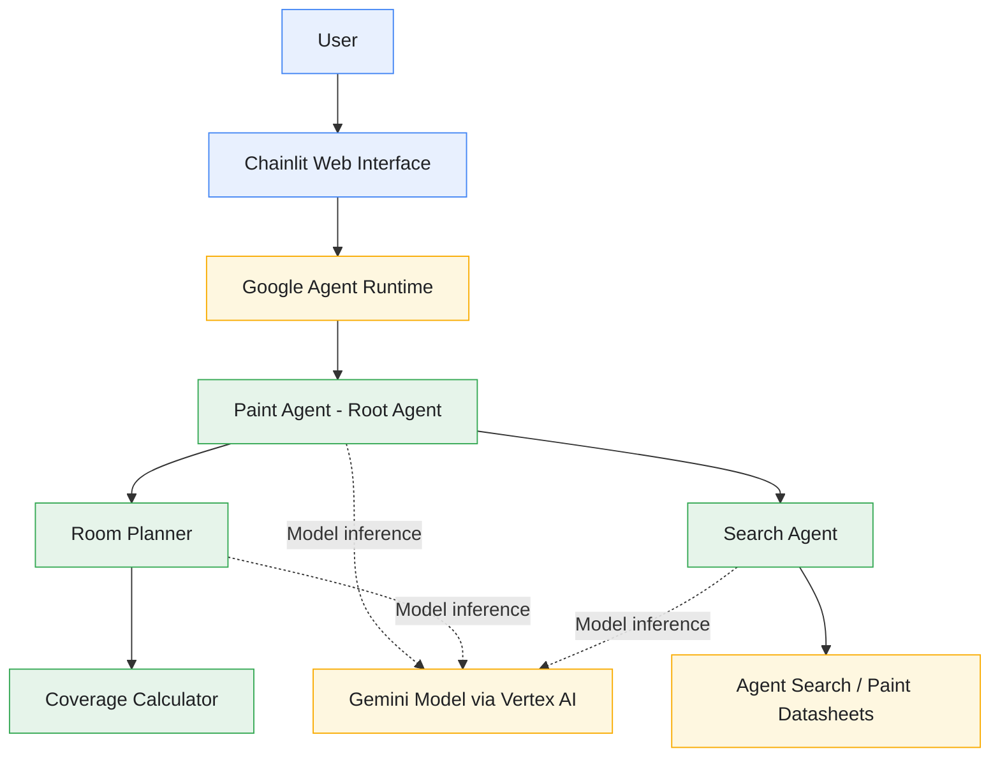

# 🎨 Paint Agent 🤖

https://github.com/user-attachments/assets/5ce7e8f8-15db-4e81-98de-7fec6ee8d9c0

> 🎥 Watch **Paint Agent** in action! 🖌

> [!CAUTION]
> The Cloud Run deployment is currently unavailable because the Google Cloud project has exhausted its available credits. The project was previously deployed and tested successfully on Google Cloud Run.

---

## Table of Contents

- [Introduction](#introduction)
- [Architecture Diagram](#architecture-diagram)
- [Project Structure](#project-structure)
- [Features](#features)
- [Tech Stack](#tech-stack)
- [Application Workflow](#application-workflow)
- [Screenshots](#screenshots)
- [Agent Behavior and Capabilities](#agent-behavior-and-capabilities)
- [AI-Assisted Development](#ai-assisted-development)
- [Google Skills Challenge Lab Reference](#google-skills-challenge-lab-reference)
- [Future Enhancements](#future-enhancements)
- [Resources](#resources)
- [Disclaimer](#disclaimer)
- [Contributing](#contributing)
- [License](#license)
- [Author](#author)

---

## Introduction

**Paint Agent** is an AI-powered paint-selection assistant developed as part of Google's hands-on **Deploy an Agent with Agent Development Kit (ADK): Challenge Lab**.

The project demonstrates how to build and deploy an agent using the **Google Agent Development Kit (ADK)**, integrate an agent with search capabilities and Python tools, manage conversation state, and interact with the deployed agent through a web application.

The assistant is designed around a paint-shopping scenario for **Cymbal Shops**. It helps users explore paint products, choose colors, provide room dimensions, estimate paint coverage, and determine paint requirements based on their selections.

The application uses a multi-agent design, combining a root agent with specialized sub-agents for tasks such as room planning, paint-coverage calculations, and paint-product information retrieval.

The project also demonstrates deployment to **Google Cloud's Agent Runtime** and the use of a **Chainlit** interface to interact with the deployed agent.

This repository documents my implementation of the challenge lab, including the agent structure, tools, workflow, and supporting resources.

---

## Architecture Diagram

The following diagram illustrates the conceptual architecture of **Paint Agent**, including the user interface, root agent, specialized sub-agents, paint-product search, and Google Cloud model services.



> [!Note]
> This is a high-level conceptual diagram of the project's components, not a verified runtime trace. The exact tool calls and execution path depend on the implementation and user request.*

### Architecture Overview

1. **User Interface**
   - Provides a web-based interface for interacting with Paint Agent.
   - Allows users to ask questions and provide paint preferences and room dimensions.
   - Displays the agent's responses.

2. **Google Agent Runtime**
   - Provides the managed environment used to deploy and query the agent.
   - Allows the application to communicate with the deployed agent.

3. **Paint Agent — Root Agent**
   - Acts as the primary agent for the paint-selection workflow.
   - Coordinates the tasks required to respond to user requests.
   - Uses available tools and specialized agents.

4. **Room Planner**
   - Supports the room-planning portion of the workflow.
   - Collects relevant room information, such as names, dimensions, and paint preferences.

5. **Coverage Calculator**
   - Supports paint-coverage calculations based on room dimensions and other relevant inputs.
   - Helps estimate the coverage required for a room.

6. **Search Agent**
   - Retrieves information from the configured paint-product search source.
   - Helps answer questions about Cymbal Shops' paint products.

7. **Gemini and Vertex AI**
   - Provide the configured model-inference capabilities used by the agent.

---

## Project Structure

The repository is organized around the **ADK agent** implementation, its specialized **sub-agents**, and the **Chainlit** user interface.

## 📁 Project Structure

```text
paint-agent/
├── adk_agent/
│   ├── chainlit_ui/
│   │   ├── .chainlit/
│   │   │   ├── translations/
│   │   │   └── config.toml
│   │   ├── public/
│   │   ├── app.py
│   │   └── chainlit.md
│   │
│   ├── paint_agent/
│   │   ├── sub_agents/
│   │   │   ├── room_planner/
│   │   │   │   ├── sub_agents/
│   │   │   │   │   └── coverage_calculator/
│   │   │   │   │       ├── __init__.py
│   │   │   │   │       ├── agent.py
│   │   │   │   │       └── tools.py
│   │   │   │   ├── __init__.py
│   │   │   │   └── agent.py
│   │   │   │
│   │   │   └── search_agent/
│   │   │       ├── __init__.py
│   │   │       └── agent.py
│   │   │
│   │   ├── __init__.py
│   │   ├── agent.py
│   │   ├── callback_logging.py
│   │   ├── tools.py
│   │   └── requirements.txt
│   │
│   ├── requirements.txt
│   └── test_adk.py
│
├── .gitignore
├── CODE_OF_CONDUCT.md
├── CONTRIBUTING.md
├── LICENSE
├── README.md
└── SECURITY.md
```

> [!Note]
> This tree represents the main project layout. Additional files may exist within the sub-agent directories. Refer to the repository for the complete source structure.

### Key Components

- **`chainlit_ui/`** — Provides the Chainlit-based user interface for interacting with the Paint Agent.
- **`paint_agent/agent.py`** — Defines the main agent and coordinates the application's agent workflow.
- **`sub_agents/room_planner/`** — Supports room-planning tasks and delegates paint-coverage calculations.
- **`coverage_calculator/`** — Contains the agent and tools for paint-coverage calculations.
- **`search_agent/`** — Handles paint-product search tasks.
- **`callback_logging.py`** — Contains callback-related logging functionality.
- **`tools.py`** — Contains tools used by the Paint Agent.
- **`requirements.txt`** — Lists Python dependencies for the corresponding project directory.
- **`test_adk.py`** — Contains ADK-related tests.
- **`CONTRIBUTING.md`, `CODE_OF_CONDUCT.md`, and `SECURITY.md`** — Describe contribution, community conduct, and security-reporting guidelines.

---

## Features

- **AI-Powered Paint Assistance:** Helps users explore paint options for home-renovation scenarios.
- **Multi-Agent Architecture:** Uses a root agent and specialized sub-agents to organize different responsibilities.
- **Paint Product Search:** Integrates search capabilities to retrieve information from paint-product datasheets.
- **Room Planning:** Supports the collection of room details and paint-selection preferences.
- **Paint Coverage Calculation:** Uses Python-based functionality to support paint-coverage estimates.
- **Color Selection:** Supports conversations about choosing colors from the available paint product lines.
- **Session State Management:** Demonstrates storing and retrieving conversation information for subsequent agent instructions.
- **Agent Tools:** Combines agent capabilities with tools used to perform specific tasks.
- **Agent Search Integration:** Uses a configured search application and data store for paint-product information.
- **Gemini Model Integration:** Uses the configured Gemini model through the Google Cloud AI platform.
- **Chainlit Web Interface:** Provides a browser-based way to interact with the agent.
- **Agent Runtime Deployment:** Demonstrates deploying the agent to a managed runtime and querying the deployed version.
- **Callback Logging:** Includes callback-related code for logging or observing agent activity.
- **Python-Based Implementation:** Uses Python for agent logic and supporting functionality.

> [!Note]
> *The actual behavior of each feature depends on the code, configuration, and availability of the connected Google Cloud services.*

---

## Tech Stack

| Technology | Purpose |
|---|---|
| **Python** | Primary programming language |
| **Google Agent Development Kit (ADK)** | Agent development and orchestration framework |
| **Gemini** | Model inference and response generation |
| **Vertex AI** | Google Cloud AI platform integration |
| **Agent Search** | Retrieval of information from paint-product datasheets |
| **Google Cloud Agent Runtime** | Managed agent deployment and execution |
| **Chainlit** | Web-based conversational interface |
| **Google Cloud Storage** | Source storage for the lab's paint-product datasheet |
| **Python Functions and Tools** | Support specialized agent operations and calculations |
| **Git** | Version control |
| **GitHub** | Source code hosting and project documentation |

---

## Application Workflow

**Paint Agent** follows a conversational workflow that combines paint-product information retrieval, room planning, and paint-coverage calculations.

### 1️⃣ User Interaction

- The user opens the Chainlit interface.
- The user starts a conversation with Paint Agent.
- The user asks about available paints or describes a painting project.

**Example requests:**

- "Can you tell me about the available paint products?"
- "I'd like to use EcoGreens."
- "I want to paint my living room and bedroom."
- "How much paint will I need for this room?"

### 2️⃣ Request Processing

- The interface sends the user's message to the configured agent.
- The root agent interprets the request and determines the next step.
- The agent uses its available capabilities to handle the request.

### 3️⃣ Paint Product Information Retrieval

- When product information is required, the search capability retrieves relevant information from the configured paint-product source.
- The agent uses the retrieved information to respond to questions about paint products.
- Product information is grounded in the available datasheets rather than relying solely on general model knowledge.

### 4️⃣ Room Planning

- The agent collects the user's room details.
- It can ask for room names, selected paint colors, and room dimensions.
- It gathers additional details required by the painting scenario.

### 5️⃣ Paint Coverage Calculation

- The relevant calculation functionality processes the provided room measurements and other required inputs.
- The agent uses the calculation results to estimate the coverage required.
- The result depends on the supplied dimensions, doors, windows, number of coats, and the calculation logic implemented in the project.

### 6️⃣ Response Generation

- The agent combines the relevant retrieved information and calculation results.
- It responds to the user with information related to the selected paint and room requirements.
- The user can continue the conversation with additional preferences or room details.

### 7️⃣ Deployment and Web Interaction

- The agent is deployed to Google Cloud's Agent Runtime as part of the challenge lab.
- The Chainlit application is configured to query the deployed agent.
- The user interacts with the agent through the web interface.

---

## Screenshots

This section will showcase the Paint Agent interface, example conversations, paint-selection workflow, and deployment.


### Paint Agent Interface


### Agent Development Kit (ADK) Web Interface


### Google Cloud Project Dashboard


### Google Cloud AI Applications


### Project Source Code


### Cloud Storage Buckets


### Cloud Shell Terminal


### Google Cloud Agent Engine Deployment


### Agent Playground and Testing


---

## Agent Behavior and Capabilities

### Paint Product Information

The search-enabled workflow is designed to help the agent answer questions about Cymbal Shops' paint products using the configured datasheet source.

The challenge scenario includes products such as Project Paint, EcoGreens, SureCoverage, and Forever Paint.

### Room and Color Details

The conversational workflow can collect information such as:

- The paint product selected by the user.
- The number and names of rooms.
- The preferred color for each room.
- The room's length, width, and height.
- The number of doors and windows.
- The number of paint coats required.

### Coverage Estimation

The coverage-calculation workflow uses room details to estimate the paint coverage required. The final estimate depends on the implemented calculation method and the information provided by the user.

### Multi-Agent Design

The project demonstrates how specialized agents can separate responsibilities such as product search and room planning. It also demonstrates the use of tools to make specific capabilities available within an agent workflow.

### Session State

Session state allows information gathered during a conversation to be stored and retrieved for later instructions. This helps support a multi-step interaction without requiring the user to repeat every previously supplied detail.

---

## AI-Assisted Development

AI tools can support software development tasks such as understanding unfamiliar code, debugging errors, exploring agent architectures, and preparing documentation.

During development and learning, AI assistance may be used to support activities such as:

- Understanding Google ADK concepts and agent structures.
- Investigating agent-tool compatibility issues.
- Understanding multi-agent orchestration.
- Troubleshooting Python code and configuration.
- Reviewing deployment steps.
- Improving documentation and project presentation.

Any AI-generated suggestions or code should be reviewed, tested, and adapted to the actual project before being treated as correct.

---

## Google Skills Challenge Lab Reference

This project was developed as part of the following Google Skills learning material.

### Course

**Deploy Multi-Agent Architectures**

[Open the Google Skills course](https://www.skills.google/course_templates/1445)

### Challenge Lab

**Deploy an Agent with Agent Development Kit (ADK): Challenge Lab**

[Open the challenge lab](https://www.skills.google/course_templates/1445/labs/647523)

### Concepts Demonstrated

The challenge lab focuses on practical experience with:

- Building an agent with Google Agent Development Kit (ADK).
- Creating a root agent and specialized sub-agents.
- Using Agent Search for paint-product information.
- Using Python functions as agent tools.
- Resolving tool-composition issues in the agent architecture.
- Storing and retrieving information through session state.
- Deploying an agent to Google Cloud's Agent Runtime.
- Querying the deployed agent through a web application.

This repository serves as a personal implementation and documentation of the learning exercise. It is intended to demonstrate the project structure and concepts explored during the challenge lab.

---

## Future Enhancements

The following ideas could be considered for future versions of Paint Agent:

- **Improved User Experience:** Enhance the web interface with clearer room and paint-selection steps.
- **Paint Product Comparison:** Help users compare available products using verified datasheet information.
- **Enhanced Coverage Estimates:** Add validation and clearer explanations of coverage calculations.
- **Multiple Room Planning:** Improve the experience of managing several rooms and different colors within one project.
- **Cost Estimation:** Expand price calculations based on selected products and calculated paint requirements, where the required pricing data is available.
- **Conversation Continuity:** Improve the handling of session state and multi-step conversations.
- **Agent Evaluation:** Add test cases to evaluate product retrieval, tool usage, calculation accuracy, and response quality.
- **Error Handling:** Improve responses when room details, configuration values, or search results are missing.
- **Observability:** Improve logging and troubleshooting of agent execution.
- **Deployment Documentation:** Document repeatable deployment and configuration steps for an independently managed environment.

> [!IMPORTANT]
> These are potential improvements rather than features claimed to be implemented in the current version.

---

## Resources

[](https://google.github.io/adk-docs/)
[](https://cloud.google.com/docs)
[](https://cloud.google.com/vertex-ai/docs)
[](https://ai.google.dev/gemini-api/docs)
[](https://docs.chainlit.io/)
[](https://docs.python.org/3/)
[](https://www.skills.google/course_templates/1445)
[](https://docs.github.com/)

---

## Disclaimer

**Paint Agent** is a learning and demonstration project developed in connection with Google's challenge lab.

The project uses third-party technologies and services, including Google Cloud, Google Agent Development Kit (ADK), Gemini, Agent Search, and Chainlit. Their availability, functionality, usage limits, pricing, and applicable policies are subject to the respective providers' terms and documentation.

Google Skills lab environments may provide temporary credentials and cloud resources that are available only for the duration of the lab. A successful lab deployment does not necessarily mean the application is permanently hosted or publicly accessible.

AI-generated responses may contain errors or omissions. Paint-product information, coverage estimates, and cost calculations should be checked against the relevant product information and calculation assumptions before being used for actual purchasing or renovation decisions.

This repository is intended for educational and demonstration purposes. Do not commit credentials, API keys, temporary lab passwords, private configuration files, or other secrets to source control.

---

## Contributing

Contributions are welcome. Before submitting changes, please review:

- [Contributing Guide](./CONTRIBUTING.md)
- [Code of Conduct](./CODE_OF_CONDUCT.md)
- [Security Policy](./SECURITY.md)

---

## License

This project is licensed under the **Apache License 2.0**.

See the [**LICENSE**](./LICENSE) file for details.

---

## Author

[**Sahil Sharma**](https://github.com/sahil-me) 

Thank you for exploring **Paint Agent**! If you find the project useful, consider giving the repository a ⭐ to show your support.
